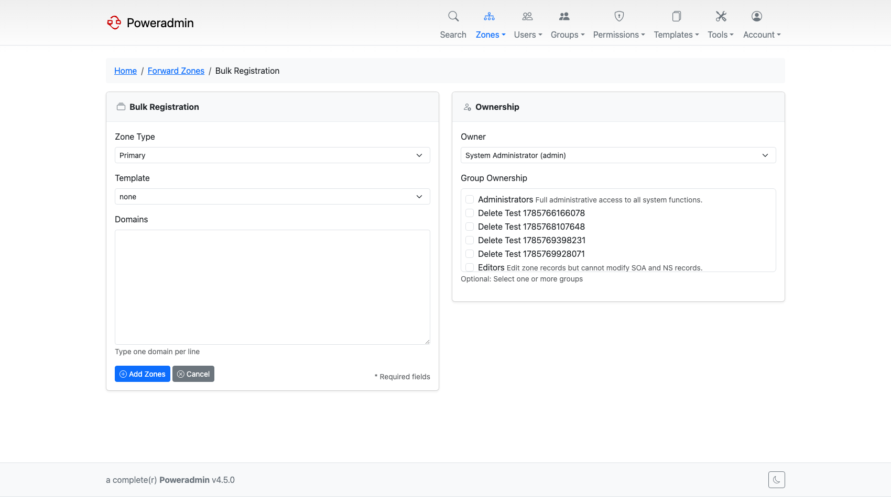

# Bulk and Batch Operations

Poweradmin has three separate features for adding records or zones in bulk. Pick the one that matches what you are creating.

| Feature | Use when | UI entry |
|---|---|---|
| [Bulk Record Add](#bulk-record-add) | Adding many records of different types into one existing zone | Zone editor → **Bulk add** |
| [Batch PTR Records](#batch-ptr-records) | Generating PTR records for a whole IPv4 or IPv6 subnet | Forward zone editor → **Generate PTR**, or top nav |
| [Bulk Zone Registration](#bulk-zone-registration) | Creating multiple zones in one step | Zones menu → **Bulk Registration** |

---

## Bulk Record Add

Adds multiple records of any supported type into a single existing zone, parsed from CSV-style input.

**Route:** `/zones/{id}/records/bulk` (the **Bulk add** button on the zone editor).

### Format

One record per line:

```
name,type,content[,priority][,ttl][,disabled][,comment]
```

- **name** - hostname relative to the zone, or `@` for the zone apex
- **type** - a record type offered for the zone (A, AAAA, CNAME, MX, TXT, SRV, ...). Reverse zones and forward zones accept different type lists, filtered by what the connected PowerDNS supports
- **content** - the record value
- **priority** - for MX/SRV; ignored for record types that have no priority
- **ttl** - optional; falls back to the zone or system default
- **disabled** - `Yes` or `No` (matches CSV export from the zone editor)
- **comment** - free-text comment

### Examples

```
www,A,192.168.1.1
www,AAAA,2001:db8::1
www2,CNAME,www.example.com.
@,MX,mail.example.com.,10
_acme,TXT,"verification=12345"
@,TXT,"v=spf1 mx a ip4:192.168.0.0/24 ~all"
_sip._tcp,SRV,"0 5060 sip.example.com.",0,3600
_sip._tcp,SRV,sip.example.com.,0,5060,3600
```

SRV has its own parser and does not follow the generic column order above. The first SRV line is the normal form (`name,SRV,"weight port target",priority,ttl`, matching CSV export); the second is the legacy form (`name,SRV,target,weight,port,ttl`), which the in-app help also labels legacy.

### Tips

- Quote any value that contains a comma or spaces.
- For CNAME, MX, SRV: end the target with a trailing dot.
- A submission may hold at most 1000 non-empty lines; a longer list is refused before anything is added.
- Lines that fail validation are skipped and listed back on the form with a warning, while the valid ones are saved. From 4.6.0, on the SQL backend an unexpected write error rolls back the whole list and reports "No records were added". On the API backend lines are written one at a time with no rollback.
- The form has a **Reason for this change** field, stored in the [change log](record-change-log.md#changesets-and-change-reasons). It is required when `logging.require_change_comment` is on.
- Records exported from a zone via **CSV export** can be re-imported with this form, but delete the header row first - `Name,Type,Content,...` is parsed as a record and rejected with "Invalid record type". The data rows import as they are.

---

## Batch PTR Records

Generates PTR records for every address in an IPv4 or IPv6 prefix in a single operation, optionally creating matching A/AAAA forward records.

**Route:** `/zones/batch-ptr` (the **Generate PTR** button on any forward zone, or **Zones → Batch PTR Records** in the top nav).

Full walkthrough with form fields, IPv4 and IPv6 examples, and permission requirements is on the [Reverse DNS (PTR Records) Guide](reverse-dns.md#method-2-using-batch-ptr-records-feature) page.

---

## Bulk Zone Registration

Creates many zones at once from a list of domain names. All zones get the same type, optional template, and ownership assignment.

**Route:** `/zones/bulk-registration` (Zones menu → **Bulk Registration**).



### Form fields

- **Domains** - one domain per line (e.g. `example.com`, `example.net`, ...)
- **Zone Type** - `MASTER` or `NATIVE`
- **Template** - optional (`none` by default); pre-populates SOA, NS, and any template records
- **Owner** - user and/or group, subject to the `dns.zone_ownership_mode` setting (see [Zone Management → Restricting Ownership Assignment](zones.md#restricting-ownership-assignment))

### Tips

- Use a zone template to keep SOA and NS records consistent across all zones being registered.
- Zones that already exist in PowerDNS are reported and skipped; the rest of the batch still proceeds.
- For reverse zones, enter the in-addr.arpa / ip6.arpa names directly (e.g. `1.168.192.in-addr.arpa`).

---

## Permissions

All three features respect the standard permission model:

- **Bulk Record Add** requires `zone_content_edit_own` (on an owned zone) or `zone_content_edit_others`.
- **Batch PTR Records** requires the `add_reverse_record` feature flag and one of `zone_content_edit_own`, `zone_content_edit_others` or `zone_content_edit_own_as_client`.
- From 4.6.0, with the [change approval workflow](change-requests.md) on, Bulk Record Add and Batch PTR are refused on a zone whose changes need review. Batch PTR without a zone is refused when `approval.require_review_for_all` is on.
- **Bulk Zone Registration** requires `zone_master_add` (and respects `dns.zone_ownership_mode`).

See [Permissions](permissions.md) for the full list of permission constants and how to assign them through permission templates.
